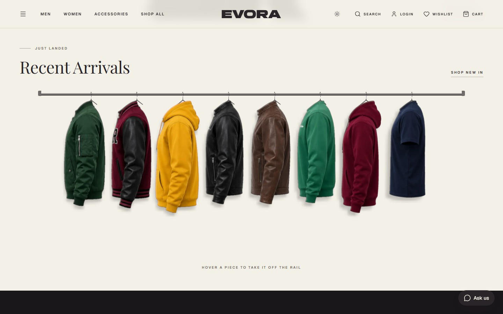
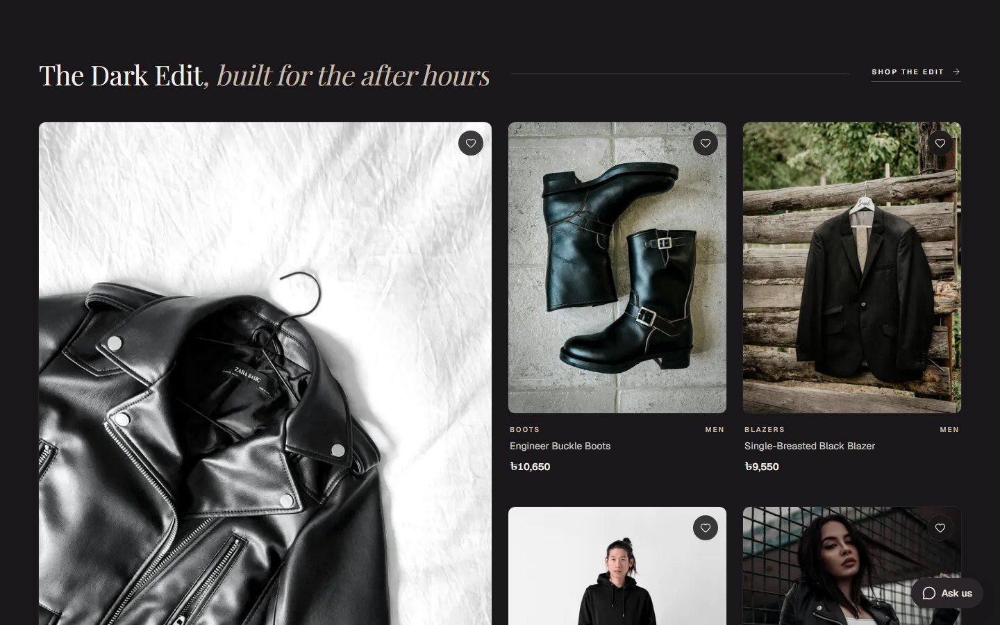
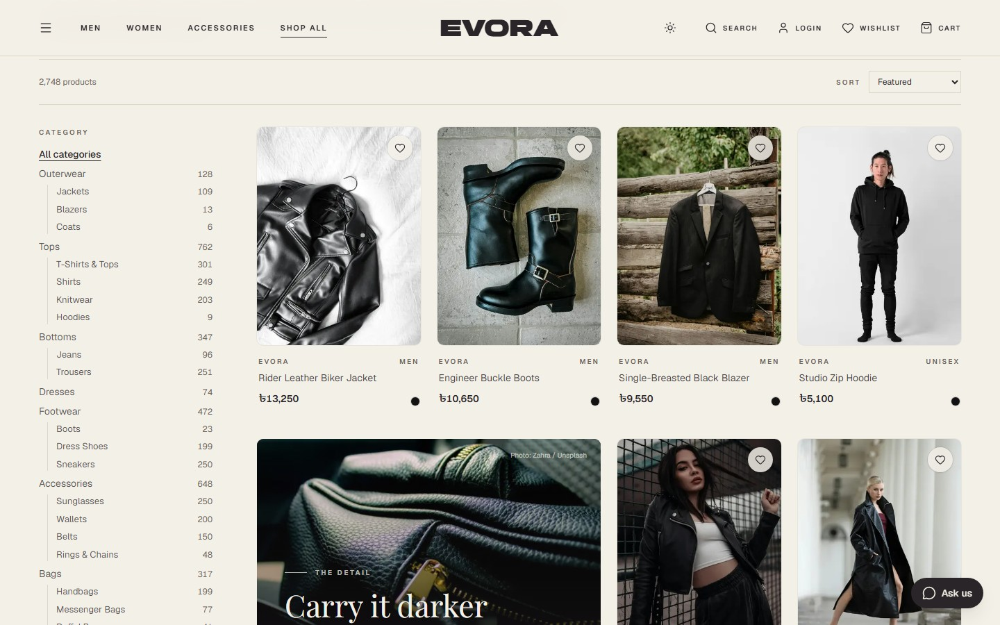
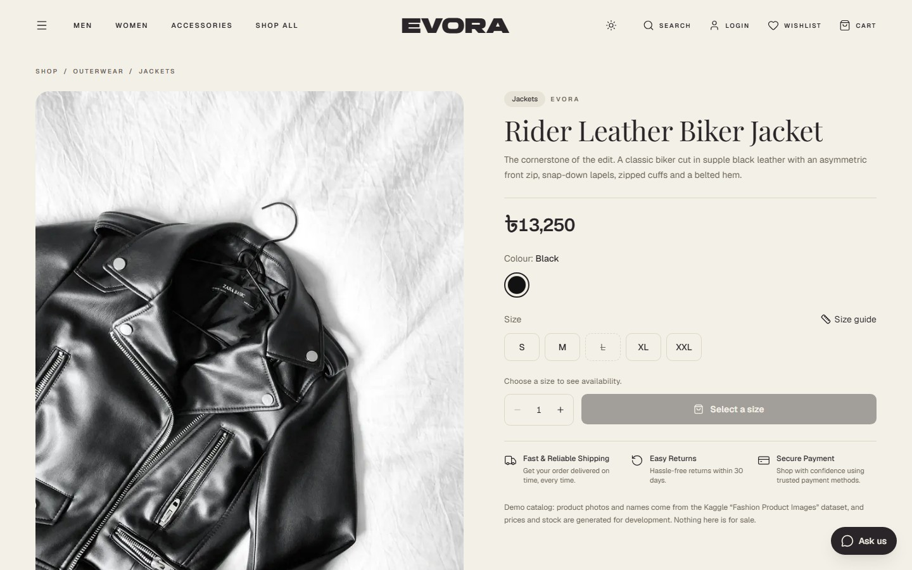
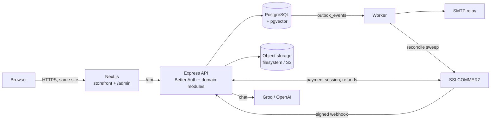

<div align="center">


# CommerceCore

<a href="https://youtu.be/TMwv6KvdtoM">
  
</a>

<sub>▶ <a href="https://youtu.be/TMwv6KvdtoM"><b>Watch the video on YouTube</b></a></sub>

**A production-minded, single-store e-commerce platform — customer storefront, protected admin dashboard, payments, inventory and a shopping assistant, built end to end.**


[Features](#features) · [Screenshots](#screenshots) · [Architecture](#architecture) · [Quick start](#quick-start) · [Testing](#testing) · [Deploying](#deploying) · [Docs](#documentation) · [Status](#project-status)

<br />


<sub>The storefront home page. The demo brand CommerceCore ships with is <b>EVORA</b>.</sub>

</div>

---

## About

CommerceCore is a complete shopping experience and the back office behind it, written to show how the hard parts of e-commerce are meant to be done: money in integer minor units, stock that can never go negative under concurrent checkout, payments confirmed by verified provider evidence instead of a browser redirect, and email that can fail without invalidating an order.

It is a **modular monolith** split into two deployables — a Next.js storefront and admin UI, and an Express API with a background worker — over one PostgreSQL database. Every rule that matters (prices, totals, stock, roles, payment state) is decided on the server from persisted data. The browser is never trusted for any of them.

The demo store is a dark-leaning menswear and womenswear label called **EVORA**, priced in BDT, with a demo catalog imported from a public fashion dataset (the screenshots below show about 2,700 products).

> **Pre-launch.** All thirteen planned milestones are implemented and tested, but the project is not approved for live payments. Provider, tax, shipping, returns and legal decisions are still open — see [Project status](#project-status) and [`docs/launch-gates.md`](docs/launch-gates.md).

## Features

### Storefront

- **Home page** with a hero slideshow, a *Recent Arrivals* clothes rail whose pieces turn to face you on hover (CSS, with an optional WebGL layer), the *Dark Edit* editorial grid, reviews, FAQ and newsletter sections.
- **Catalog** with server-side search, category facets, filters, sorting and pagination, SEO-friendly slugs, and sitemap / robots / JSON-LD output.
- **Product pages** with colour and size selection, sold-out sizes shown as such, and a quantity selector.
- **Bag and wishlist** for signed-in customers, with price-change notices and server-side revalidation of stock and price.
- **Accessible and responsive**: route transitions with matching loading skeletons, light and dark themes, reduced-motion support, and an automated axe WCAG 2.1 AA gate on seven pages.

### Checkout, payments and orders

- **Server-priced checkout** — the client sends variant IDs and quantities, never totals. Checkout refuses an order whose total changed after the customer saw it, and is protected by an idempotency key.
- **Cash on delivery** and **online payment through the SSLCOMMERZ sandbox** (bKash, cards and mobile banking on its hosted page), with signed-webhook verification, event de-duplication and a reconciliation sweep, so a payment that succeeds after the browser closes is still recovered.
- **Coupons** entered at checkout, with usage limits that hold under concurrent redemption; administrator-set delivery fees, free-delivery threshold and tax rate.
- **Order tracking** for customers, who can cancel until an order is being prepared.
- **Purchase-time snapshots** of every item's name, SKU and price, so editing or archiving the catalog never rewrites history.

### Admin dashboard (`/admin`)

- Sales overview, **orders** (forward-only fulfilment transitions, tracking, cash collected, idempotent refunds, held-payment resolution), **products**, **categories**, **inventory** with a full stock-movement history, **customers**, **coupons**, **settings**, an **audit log**, CSV order export, and a **jobs** screen for the background queue.
- Roles `CUSTOMER < ADMIN < SUPERADMIN`, enforced on every API route. Hiding a button is not authorization — direct API calls are tested too.
- Every sensitive change is written to the audit log.

### Background work

- A durable **outbox + worker**: receipts, shipping, cancellation and refund emails, low-stock and payment-review alerts, and password-reset links. Jobs are claimed with `FOR UPDATE SKIP LOCKED`, sent outside any transaction, and retried with bounded exponential backoff and jitter. Dead jobs are visible and retryable from the admin UI.

### Shopping assistant

- An **"Ask us" chat widget** over Groq (answers) with optional OpenAI (embeddings and fallback). It has read-only tools over the catalog, delivery settings and a signed-in customer's *own* orders, plus pgvector retrieval over policy text and public products. Replies stream. Prices and stock always come from the database, never from the search index, and a provider outage disables only the assistant, never shopping.

## Screenshots

<table>
  <tr>
    <td width="50%"><br /><sub><b>Recent Arrivals</b> — pieces hang side-on and turn to face you on hover.</sub></td>
    <td width="50%"><br /><sub><b>The Dark Edit</b> — a curated grid with one-tap wishlist hearts.</sub></td>
  </tr>
  <tr>
    <td width="50%"><br /><sub><b>Shop</b> — server-side facets, sorting and pagination over the whole catalog.</sub></td>
    <td width="50%"><br /><sub><b>Product page</b> — sizes with live availability; add to bag unlocks once a size is chosen.</sub></td>
  </tr>
</table>

<p align="center">
  <br />
  <sub><b>Mobile</b> — the same hero at 390 px wide.</sub>
</p>

> Screenshots are taken from the local development build with the demo catalog. The admin dashboard needs a signed-in administrator and is not pictured here.

## Architecture



- **Modular monolith.** One API process, one database, clear module boundaries (`identity`, `catalog`, `cart`, `wishlist`, `pricing`, `coupons`, `inventory`, `checkout`, `orders`, `payments`, `refunds`, `notifications`, `jobs`, `settings`, `analytics`, `audit`, `admin`, `assistant`). Microservices are deliberately not used.
- **PostgreSQL is authoritative** for catalog, prices, orders, payments and inventory. Critical invariants are enforced with constraints, conditional atomic writes and row locks, not application-level hope.
- **Short transactions.** No payment or email network call ever waits inside a database transaction.
- **Same-site in production.** The API is served under the storefront's host at `/api` (or a sibling subdomain with a shared cookie domain), and refuses to boot otherwise ([ADR 0024](docs/decisions/0024-staging-production-readiness.md)).

### How an order is placed

1. The storefront asks `POST /checkout/quote`; the server prices the cart from persisted data (delivery, coupon and tax included).
2. `POST /checkout` runs **one transaction** that creates the order and its snapshots, claims stock atomically, records the stock movements, writes the payment row and status history, applies the coupon, and queues the receipt in the outbox. A repeated request with the same idempotency key returns the first result; the same key with a different payload is a conflict.
3. For an online payment, a payment session is opened **after** the commit. The customer pays on the provider's hosted page.
4. The provider's signed webhook is verified, de-duplicated and applied through an explicit payment state machine. The browser return is never treated as proof of payment, and a sweep reconciles anything missed.
5. The worker sends the receipt. If email is down, the order stands and the job retries.

## Engineering guarantees

| Guarantee | Where it is proven |
|---|---|
| Concurrent purchase of the final unit never makes stock negative | `inventory.test.ts`, `checkout.test.ts` (final-unit race) |
| A repeated checkout does not create a second order; a different payload under the same key conflicts | `checkout.test.ts` |
| Manipulated price, invalid quantity, unavailable stock and expired coupons are rejected | `checkout.test.ts`, `admin-completeness.test.ts` |
| Duplicate and out-of-order webhooks cause no duplicate effects; payment success survives a closed browser | `payments.test.ts` |
| Refunds cannot be duplicated, even by two administrators at once or after a lost provider answer | `order-management.test.ts` |
| Coupon usage limits hold when eight customers race for three uses | `admin-completeness.test.ts` |
| Customers cannot read another customer's orders or addresses; non-admins cannot call admin APIs | `authorization.test.ts`, `e2e/tests/access-control.spec.ts` |
| An email outage does not invalidate a committed order, and retries are observable | `jobs.test.ts` |
| Passwords, tokens and secrets never reach the logs | `logger.test.ts` |
| The browse → bag → checkout → ship → track journey works in a real browser | `e2e/tests/checkout-journey.spec.ts` |

## Tech stack

| Layer | Technology |
|---|---|
| **Storefront and admin UI** | Next.js 16 (App Router), React 19, TypeScript (strict), Tailwind CSS 4, Base UI / shadcn, TanStack Query, React Hook Form + Zod, Framer Motion, GSAP, Lenis, three.js / React Three Fiber, next-themes |
| **API and worker** | Node.js ≥ 22.12, Express 5, Better Auth, Zod, Pino, Helmet, express-rate-limit, Nodemailer, AWS SDK (S3) |
| **Data** | PostgreSQL 17 with pgvector, Prisma 7 (`@prisma/adapter-pg`) |
| **Payments** | SSLCOMMERZ (sandbox) behind a provider interface, with a local fake gateway for development |
| **AI** | Groq chat, optional OpenAI embeddings and fallback, behind a single `fetch` adapter; local stand-ins for both |
| **Testing** | Vitest (unit, database and HTTP integration), Playwright with axe-core |
| **Delivery** | Docker images for the API, worker, migrate job and storefront; Docker Compose + Caddy staging rehearsal; GitHub Actions CI |

## Quick start

### Prerequisites

- **Node.js ≥ 22.12** and npm (CI uses Node 24)
- **PostgreSQL 17+ with the [pgvector](https://github.com/pgvector/pgvector) extension** — the `assistant` migration runs `CREATE EXTENSION vector`, so migrations fail without it. The simplest route is the image CI uses:

  ```bash
  docker run -d --name commercecore-db -p 5432:5432 -e POSTGRES_USER=commercecore -e POSTGRES_PASSWORD=<choose-a-password> -e POSTGRES_DB=commercecore pgvector/pgvector:0.8.6-pg17
  ```

  To run the database and integration tests you also need a **separate, disposable** test database (those suites truncate every table):

  ```bash
  docker exec commercecore-db createdb -U commercecore commercecore_test
  ```

### 1. Backend

```bash
cd backend
cp .env.example .env        # then edit it (see below)
npm install
npm run prisma:deploy       # apply migrations
npm run prisma:seed         # sample categories and products, plus an admin account
npm run dev                 # API on http://localhost:4000
```

In `backend/.env`, set at least:

- `DATABASE_URL` — your PostgreSQL connection string.
- `BETTER_AUTH_SECRET` — generate one with `openssl rand -base64 32`. Placeholder values are rejected at boot, so a fresh clone cannot start with a publicly known signing secret.
- `SEED_ADMIN_EMAIL` and `SEED_ADMIN_PASSWORD` (12 characters or more) — the seed creates a `SUPERADMIN` only when a password is set; there is no default password. That account can open `/admin`.

In a second terminal, start the background worker (emails, retries and the payment sweep):

```bash
cd backend
npm run worker:dev
```

In development, email is written as `.eml` files under `backend/.data/mail` and nothing is sent.

### 2. Frontend

```bash
cd frontend
cp .env.example .env.local
npm install
npm run dev                 # storefront on http://localhost:3000
```

> **Use `localhost` for both, not `127.0.0.1`.** They are different sites to a browser, and the development session cookie is `SameSite=Lax`, so mixing them makes sign-in fail silently.

### 3. Optional: the full demo catalog

The seed gives you a small catalog. For a full demo catalog like the one in the screenshots, import the Kaggle *Fashion Product Images* dataset (development and demo use only; add `--limit=<n>` to import fewer products):

```bash
cd backend
npm run catalog:import -- --demo-pricing --demo-stock --publish
npm run catalog:dark-edit    # the featured "Dark Edit"
npm run catalog:rail         # the home page clothes rail
```

Setup, flags and the download options are in [`docs/fashion-catalog-setup.md`](docs/fashion-catalog-setup.md). The importers refuse to run with `NODE_ENV=production`, and reruns never overwrite live stock or prices.

### 4. Optional: try online payments and the assistant without accounts

```bash
cd backend
npm run payments:fake-gateway   # stand-in for SSLCOMMERZ; prints the lines to add to backend/.env
npm run assistant:fake-llm      # stand-ins for Groq and OpenAI; see docs/assistant-setup.md
```

Without payment credentials the store offers cash on delivery only. For real Groq or OpenAI keys, follow [`docs/assistant-setup.md`](docs/assistant-setup.md).

## Testing

| Command | What it runs | Needs |
|---|---|---|
| `npm run typecheck` · `npm run lint` · `npm run build` | Types, lint and the production build — in both `backend/` and `frontend/` | — |
| `npm test` (backend) | Unit tests | Nothing |
| `npm run test:db` (backend) | Constraint tests against a real PostgreSQL | `DATABASE_URL_TEST` |
| `npm run test:integration` (backend) | HTTP integration tests: concurrency, webhooks, authorization, refunds, jobs | `DATABASE_URL_TEST` |
| `npm test` (`e2e/`) | Playwright journeys and the accessibility gate | A PostgreSQL server |
| `npm run perf:explain` (backend) | Query plans at a defined data volume ([`docs/performance-review.md`](docs/performance-review.md)) | A scratch database |

> `DATABASE_URL_TEST` **must point at a separate database** — the database and integration suites truncate every table, and refuse to run if it equals `DATABASE_URL`.

The browser tests start their own API (port 4010) and a production build of the storefront (port 3010) against a `commercecore_e2e` database they create and reset on every run, on the same server as `DATABASE_URL_TEST` (or set `DATABASE_URL_E2E`). They never touch your dev servers or data:

```bash
cd e2e
npm install
npx playwright install chromium
npm test
```

[`.github/workflows/ci.yml`](.github/workflows/ci.yml) runs all of the above, the dependency audit, and the container image builds on every push and pull request.

## Deploying

Production must be **same-site**: the API under the storefront's host at `/api` (preferred), or on a sibling subdomain with `AUTH_COOKIE_DOMAIN`. Images are `backend/Dockerfile` (API, worker and a one-shot migrate job) and `frontend/Dockerfile`. The procedure, including migrations and rollback, is [`docs/runbooks/deploy.md`](docs/runbooks/deploy.md).

To rehearse the whole production-mode stack on one machine (Docker):

```bash
cd deploy/staging && ./setup.sh && docker compose up -d --build   # http://localhost:8080
node deploy/smoke/smoke.mjs http://localhost:8080 --account       # from the repository root
```

Runbooks cover [deploy](docs/runbooks/deploy.md), [backup and restore](docs/runbooks/backup-restore.md), [monitoring](docs/runbooks/monitoring.md) and [incident response](docs/runbooks/incident-response.md). Measured load-test results are in [`docs/load-test.md`](docs/load-test.md).

## Repository layout

```text
CommerceCore/
├── frontend/              Next.js storefront and the /admin dashboard
├── backend/
│   ├── src/modules/       Domain modules (checkout, payments, inventory, assistant, ...)
│   ├── prisma/            Schema, migrations and the repeatable seed
│   ├── scripts/           Catalog importers, payment reconcile + fake gateway, assistant tools
│   └── tests/             Unit, database and HTTP integration tests
├── e2e/                   Playwright journeys against the whole stack
├── deploy/                Staging rehearsal, smoke test, load test, restore drill
├── docs/                  PRD, architecture, database design, API spec, ADRs, runbooks
├── .github/workflows/     CI
├── CLAUDE.md              Engineering rules and commerce invariants for AI-assisted work
└── plan.md                Homepage design roadmap
```

## Documentation

| Document | What it covers |
|---|---|
| [`docs/PRD.md`](docs/PRD.md) | Scope, personas, functional requirements, acceptance criteria and open decisions |
| [`docs/architecture.md`](docs/architecture.md) | HLD and LLD, critical flows, inventory concurrency, webhook idempotency, security |
| [`docs/database-design.md`](docs/database-design.md) | Entities, relationships, constraints, indexes and transactions |
| [`docs/API_SPEC.md`](docs/API_SPEC.md) | REST contracts, access rules, errors and idempotency |
| [`docs/implementation-plan.md`](docs/implementation-plan.md) | Milestones M0–M13, what each delivered and what it left undone |
| [`docs/decisions/`](docs/decisions) | 27 architecture decision records |
| [`docs/launch-gates.md`](docs/launch-gates.md) | Every gate that must be signed before live launch, and its evidence |
| [`docs/runbooks/`](docs/runbooks) | Deploy, backup and restore, monitoring, incident response |
| [`docs/assistant-setup.md`](docs/assistant-setup.md) · [`docs/assistant-rag-plan.md`](docs/assistant-rag-plan.md) | Running and designing the shopping assistant |
| [`docs/fashion-catalog-setup.md`](docs/fashion-catalog-setup.md) | Loading the demo catalog |
| [`docs/performance-review.md`](docs/performance-review.md) · [`docs/load-test.md`](docs/load-test.md) | Query cost and measured capacity |
| [`SYSTEM_DESIGN_NOTES.md`](SYSTEM_DESIGN_NOTES.md) · [`INSTRUCTION.md`](INSTRUCTION.md) | System-design learning notes and the lesson workflow |

## Project status

| | Milestone | Status |
|---|---|---|
| M0–M1 | Repository, decisions, foundation | ✅ Done |
| M2 | Identity and authorization | ✅ Done |
| M3 | Catalog, importer, admin catalog CRUD | ✅ Done — admin image *upload* not built (metadata only) |
| M4 | Inventory | ✅ Done |
| M5 | Cart and pricing | ✅ Done — signed-in carts only ([ADR 0014](docs/decisions/0014-account-only-cart-and-protected-routes.md)) |
| M6 | Checkout and orders | ✅ Done — delivery fees and zones are provisional |
| M7 | Sandbox payments and webhooks | 🟡 Built and tested against a local stand-in; **not yet run through the real SSLCOMMERZ sandbox** |
| M8 | Order management, cancellation, refunds | ✅ Done — no customer returns flow |
| M9 | Background jobs and email | 🟡 Built and tested; **no email provider chosen**, email verification stays off |
| M10 | Admin completeness | ✅ Done |
| M11 | Hardening and testing | ✅ Done — payment, reset-email and some admin screens are not driven by a browser |
| M12 | Staging and production readiness | 🟡 Engineering rehearsed locally; **hosting and launch gates are open** |
| M13 | Shopping assistant | 🟡 Built and tested against stand-ins; **not yet run against real Groq/OpenAI** |

**Before this can take real money**, the open gates are: a live payment provider approval, an email provider and sender domain, tax rules, real shipping zones and fees, a cancellation / refund / returns policy, legal review of the terms and privacy notice, a guest-checkout decision, a Content-Security-Policy, an independent security review, and a licence for the display font. The full list, with owners, is in [`docs/launch-gates.md`](docs/launch-gates.md).

### Known limitations

- Sample reviews, and any FAQ answer or store promise that waits on an undecided policy, are hidden in production builds (set `NEXT_PUBLIC_SHOW_UNCONFIRMED_CONTENT=true` for a staging review). The newsletter shows no form until sign-up has a backend.
- Price sorts and text search still scan the catalog (about 300 ms and 200 ms at 20,000 products); [`docs/performance-review.md`](docs/performance-review.md) gives the fix and when to apply it.
- A manual keyboard and screen-reader pass, and mobile viewport coverage in the browser suite, are still owed.

## Assets and licensing

- **Demo catalog.** Product photos and names come from the Kaggle [*Fashion Product Images*](https://www.kaggle.com/datasets/paramaggarwal/fashion-product-images-dataset) dataset, whose imagery originates from a retailer. It is for **development and demo use only** and must not be deployed as a real store. Prices and stock are generated.
- **Photography.** Some editorial photos are from Unsplash and carry on-page credits.
- **Display font.** `Brigends_Expanded.otf` is a personal-use demo font; buy a licence or replace it before launch.
- **Code.** No licence file has been added to this repository yet, so all rights are reserved by default. Choose a licence before inviting contributions or reuse.

## Working on this project

Read [`CLAUDE.md`](CLAUDE.md) first — it sets the engineering rules (server-side validation, ownership checks, idempotent mutations, short transactions, no secrets in logs) and the ten commerce invariants every change must preserve. Work in small milestones, implement features end to end with tests, and keep the docs and ADRs in step with the code.
