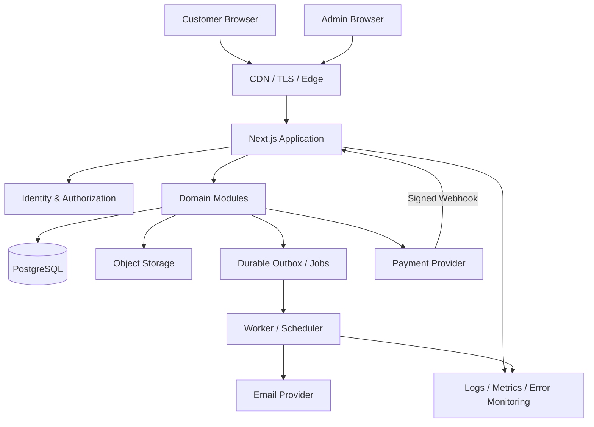
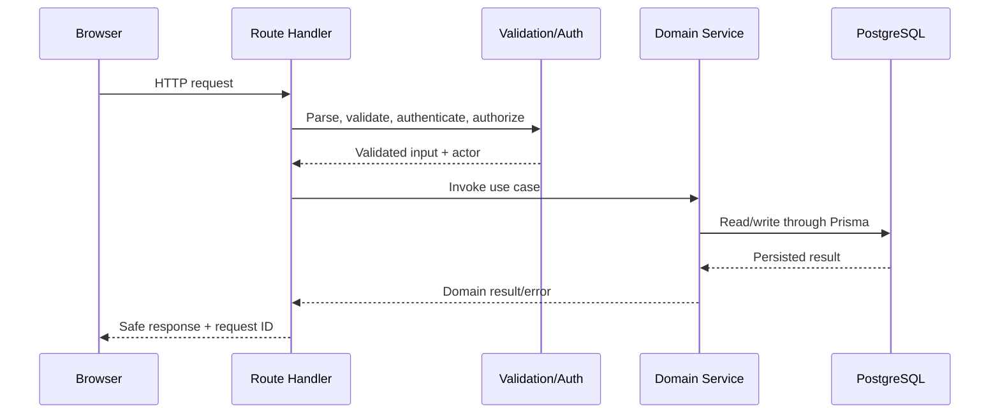

# CommerceCore — System Architecture (HLD & LLD)

**Status:** Proposed baseline. Confirm provider/deployment specifics before live production.  
**Style:** Modular monolith. **Stack:** Next.js, React, TypeScript, PostgreSQL, Prisma; object storage for images. Redis is optional.

> **Superseded in part by [ADR 0006](decisions/0006-separate-frontend-backend-express-better-auth.md).**
> The repository is split into `frontend/` (Next.js) and `backend/` (Express 5 + Better Auth + Prisma).
> The request boundary is Express, not Next.js route handlers, so §2 ("Next.js route handlers"),
> the single-app HLD box in §2 and the single `src/` tree in §6 are historical for the transport
> layer. Everything else here — module boundaries (§4), checkout/payment flow (§7), inventory
> concurrency (§8), webhook idempotency (§9), security (§12), errors (§13) — still applies, and
> ADR 0006 adds cross-origin cookie/CSRF obligations that a same-origin app would not have had.

## 1. Goals
Reliable order/payment/inventory behavior under retries and concurrency; clear domain boundaries; server-side security; testable rules; reproducible deployment; avoid premature distributed-system complexity.

## 2. HLD


### Components
- **UI:** customer storefront and protected admin pages.
- **Request boundary:** Next.js route handlers (and server actions only where appropriate) parse, validate, authenticate, invoke services and return safe responses.
- **Domain modules:** identity, catalog, cart, pricing/coupons, inventory, checkout, orders, payments, refunds, customers, notifications, analytics and audit.
- **Persistence:** PostgreSQL source of truth; Prisma data access/migrations.
- **Object storage:** image binaries; DB holds object key/URL, alt text and sort order.
- **External providers:** payment and email. Webhooks verified; provider failures are recoverable.
- **Background work:** durable outbox/queue for email, low stock, reservation expiry and reconciliation. Avoid in-memory fire-and-forget in serverless deployments.
- **Observability:** structured logs, error monitoring, metrics, health checks and alerts.

## 3. Why modular monolith
One deployable app and one relational database keep operations and cross-domain transactions simpler. Modules retain boundaries for testing and possible future extraction. Microservices should be reconsidered only when measured independent scaling, team ownership or isolation benefits exceed network/operations/consistency costs.

## 4. LLD module boundaries
| Module | Responsibility | Boundary rule |
|---|---|---|
| Identity | User/session lifecycle | Never decides pricing or stock |
| Authorization | Role and resource permission checks | No frontend-only checks |
| Catalog | Products, variants, categories, images, public queries | Does not own payment state |
| Cart | Cart lifecycle, item changes, guest merge | Cart totals are not checkout truth |
| Pricing/Coupons | Authoritative price and discount calculation | Never trust client totals |
| Inventory | Stock updates, movements, reservations | No negative stock; record every adjustment |
| Checkout | Orchestrate validation, order creation and payment setup | No network call inside DB transaction |
| Orders | Snapshots, lifecycle, status history | Never recalculate historical order from current catalog |
| Payments | Provider adapter, attempts, webhook processing | Redirect is not proof of payment |
| Refunds | Eligibility, provider refund and deduplication | No duplicate refund effect |
| Admin | Protected management use cases and audit | Must use domain rules |
| Notifications | Durable async email/alerts/retries | Email cannot invalidate an order |
| Analytics | Aggregated reports | Expensive reports must not block checkout |

Typical module layout: `route.ts`/controller, validation schema/DTO, service/use-case, and persistence functions where useful. Avoid layers that only forward calls without clarifying ownership.

## 5. Request flow

Routes are transport adapters; business rules live in services. Database constraints remain final guardrails. Convert domain errors to stable HTTP errors; never leak SQL or stack traces.

## 6. Suggested source structure
```text
src/
  app/(store)/  app/(auth)/  app/account/  app/admin/  app/api/v1/
  components/ui/ components/storefront/ components/admin/
  modules/identity/ catalog/ cart/ pricing/ coupons/ inventory/
          checkout/ orders/ payments/ refunds/ customers/
          notifications/ analytics/ audit/
  lib/auth/ db/ env/ errors/ http/ logging/ rate-limit/ storage/ validation/
  jobs/ tests/
prisma/schema.prisma
prisma/migrations/
prisma/seed.ts
```
Adapt to the actual repo and Next.js version; do not restructure working code just to match the sketch.

**As built (frontend):** `frontend/src/app/(store)/layout.tsx` mounts the storefront chrome — skip link, `SiteHeader`, the `<main>` landmark, `SiteFooter` (`components/layout/storefront-shell.tsx`) — once for every customer-facing page, including `/account`, which lives at `(store)/account/` rather than beside the group as sketched above. Pages render inside that `<main>` and must not add their own. Only `/auth` (with `/sign-in`/`/sign-up`, which are 307 config redirects to it in `frontend/next.config.ts`, query string passed through; not pages, because a page reading `searchParams` outside `<Suspense>` fails prerendering under `cacheComponents`) and the future `app/admin/` dashboard sit outside the group and render without the navbar and footer. The root `not-found.tsx` mounts the shell itself, because an unmatched URL renders under the root layout, outside every group. The storefront opens light whatever the OS setting; the header's theme toggle (`components/layout/theme-toggle.tsx`, in the menu panel on phones) switches to the theme's dark palette, which next-themes remembers per browser. The switch is a view transition: the new theme is revealed by a circle growing from the viewport's bottom-left corner (`globals.css`), and it is instant where view transitions are unsupported or reduced motion is requested. The auth page keeps its own fixed colours in both themes. Colour, radius and shadow tokens come straight from `frontend/charcoal-ivory-theme/styles/tokens.css` (the design source, imported by `app/globals.css`, which only maps them onto Tailwind utilities); the display font is loaded from the same folder.

The header's bottom rule is transparent while the page is at the top, so the bar and whatever runs up to it (the home hero) read as one surface; it fades in once content scrolls underneath. The home page (`(store)/page.tsx`) is the campaign hero in `components/storefront/fashion-hero/`: three slides whose copy, CTA routes, model PNGs (`public/images/Hero/`) and per-breakpoint placement live in `slides.ts`, so a campaign change is a data edit. It autoplays every 8 s and pauses on mouse hover, keyboard focus inside it, a hidden tab, or its pause button (WCAG 2.2.2). The first slide is server-rendered visible (its model is the LCP image, preloaded); later slides' images are fetched after load. Motion is split between Framer Motion and GSAP with one owner per animated property — see [ADR 0010](decisions/0010-motion-framer-and-gsap-ownership.md). Below the hero, the "Why shop with us?" band (`components/storefront/why-shop-with-us/`) is a Server Component whose four benefits live in `benefits.ts`; their wording (notably the 30-day return window) is copy, not policy, until PRD §9's shipping and refund decisions are made. Next, "What our customers say" (`components/storefront/customer-reviews/`) shows testimonial cards from `reviews.ts`. There is no `Review` model yet, so these are samples, labelled "Sample review" on the page; the `Review` type allows "Verified purchase" only on `customer` entries, and avatars are initials, because a stock portrait beside an invented quote would present a real person as endorsing the store (the Pexels licence forbids implying endorsement). Home sections open with `components/storefront/section-heading.tsx` and reveal on first scroll into view through `components/storefront/reveal.tsx`, a small client wrapper in which Framer Motion owns each item's opacity and transform.

**As built (catalog and cart, Phase 3):** listing pages (`(store)/shop`, `collections/{men,women,new}`, `search`) are static shells around `components/catalog/catalog-browser.tsx`, a Client Component that keeps every filter in the URL and reads `/products`, `/products/facets` and `/categories` through TanStack Query (previous page kept on screen while the next loads; default order `featured`, ADR 0013). The home page's `components/storefront/dark-edit` section reads the first eight featured products through the same query. `(store)/products/[slug]` is server-rendered per request inside `<Suspense>` (price and availability must be current), with `not-found.tsx` and `error.tsx` beside it; `components/product/product-purchase.tsx` resolves colour + size to exactly one variant id before add-to-bag. `(store)/cart` and the header badge share one `['cart']` query that every cart mutation replaces with the server's re-priced cart. Backend: `modules/catalog` (publication rule in `publication.ts`, parameterised listing SQL in `catalog.query.ts`) and `modules/cart` — see [ADR 0012](decisions/0012-public-catalog-api-and-cart-ownership.md).

## 7. Checkout/payment flow
1. Client sends variant IDs, quantities, address/contact, delivery option, coupon and idempotency key—not trusted prices/totals.
2. Authenticate or establish permitted guest identity; validate input and idempotency key.
3. In a short transaction, reload active variants/prices, validate coupon/shipping, atomically claim stock or create reservations, create order and immutable item snapshots, record initial payment state and durable outbox event.
4. Commit before calling external provider.
5. For online payment, create/confirm provider payment outside transaction using stable provider idempotency where supported; persist provider reference.
6. Verify webhook signature; deduplicate event; validate transition; update payment/order/inventory state in short transaction.
7. Confirmation page reads persisted state. Queue receipt from outbox.

Inventory policy is unresolved: decrement-on-order is simpler but needs compensation on payment failure/abandonment; timed reservation needs expiry/release and late-payment reconciliation. Decide in ADR before checkout implementation.

## 8. Inventory concurrency
Use a conditional atomic update or appropriate row lock. Example:
```sql
UPDATE product_variants
SET stock_quantity = stock_quantity - $1, updated_at = NOW()
WHERE id = $2 AND stock_quantity >= $1
RETURNING id, stock_quantity;
```
No returned row means stock could not be claimed. Perform related writes transactionally. For multi-item orders, use stable lock order and safe deadlock retries.

## 9. Webhook idempotency
- Verify provider signature against required raw body using official library.
- Store unique `(provider, eventId)`.
- Duplicate event must not repeat side effects.
- Make transitions conditional and safe to repeat.
- Handle out-of-order events by checking state and querying authoritative provider status if needed.
- Acknowledge promptly per provider requirements; retry recoverable processing failures and support reconciliation.

## 10. Cache policy
Start without Redis unless needed. Use framework/CDN caching for safe public catalog reads where invalidation is clear. Never publicly cache personalized account/cart/order/admin data. Checkout price and stock always come from authoritative current data. Invalidate catalog cache on admin updates. If Redis is introduced, document key, TTL, invalidation, stale-read tolerance and outage fallback. Tune queries/indexes before caching a slow query.

## 11. Background jobs
Durable jobs for receipts, shipping updates, low-stock alerts, reservation expiry and payment reconciliation. Track stable job identity, attempts, next-run time, last error and terminal failure. Use bounded exponential backoff with jitter; handlers must be idempotent.

## 12. Security
TLS; maintained auth/session library; secure cookies and CSRF protection appropriate to the auth model; server-side role/ownership checks; rate limits for login/reset/search suggestions/coupon/checkout/guest lookup; schema validation; safe rendering; upload size/type/signature restrictions; signed upload URLs; no raw card data; verified webhooks; secret redaction; least-privilege credentials; audit role changes, inventory, refunds, coupons, settings and admin transitions.

## 13. Errors
Suggested codes: `VALIDATION_ERROR`, `UNAUTHENTICATED`, `FORBIDDEN`, `NOT_FOUND`, `CONFLICT`, `OUT_OF_STOCK`, `COUPON_INVALID`, `IDEMPOTENCY_CONFLICT`, `PAYMENT_PENDING`, `RATE_LIMITED`, `INTERNAL_ERROR`. Include request ID; keep internal details in redacted server logs.

## 14. Observability and operations
Measure route latency/error rates, checkout failures, inventory conflicts, reservation expiry, webhook verification/duplicates/failures, payment reconciliation drift, queue depth/age/retries, email failures, DB pool saturation and slow queries. Configure actionable alerts, health checks, backup/restore drills and an incident runbook.

## 15. Deployment
One web app plus worker/scheduler if needed; managed PostgreSQL with backups; object storage; provider secrets through secret management; separate dev/test/staging/prod; CI for lint/type-check/tests/build; controlled migrations (not each app instance startup); rollback/forward-fix notes.

## 16. Open production decisions
Payment provider/country/currency; guest checkout; inventory policy; coupon stacking and concurrency; tax rules; shipping zones/fees; cancellation/refund and COD behavior; retention/deletion; hosting/storage/email/queue; measurable load profile, availability SLO, RPO/RTO; a commercial licence for the display font — `frontend/charcoal-ivory-theme/fonts/Brigends_Expanded.otf` is Multype Studio's personal-use demo, which watermarks digits and symbols (replace the file, same family name, before launch).

**Do not claim 50,000 concurrent users or 99.9% availability until the deployed system has been load-tested and the hosting/operations design supports those claims.**
