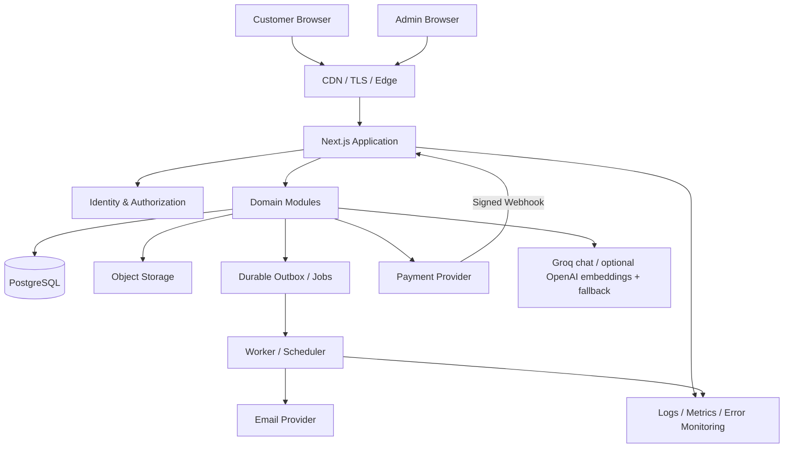
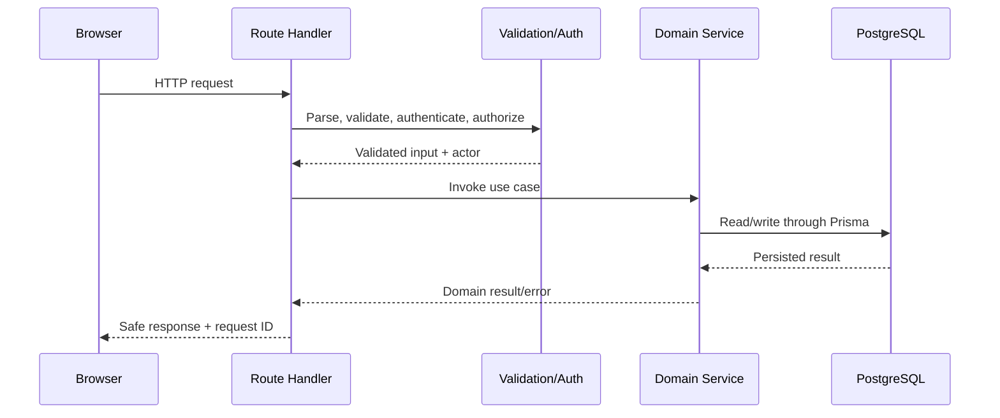

# CommerceCore — System Architecture (HLD & LLD)

**Status:** Proposed baseline. Confirm provider/deployment specifics before live production.  
**Style:** Modular monolith. **Stack:** Next.js, React, TypeScript, PostgreSQL, Prisma; object storage for images. Redis is optional.

> **Superseded in part by [ADR 0006](decisions/0006-separate-frontend-backend-express-better-auth.md).**
> The repository is split into `frontend/` (Next.js) and `backend/` (Express 5 + Better Auth + Prisma).
> The request boundary is Express, not Next.js route handlers, so §2 ("Next.js route handlers"),
> the single-app HLD box in §2 and the single `src/` tree in §6 are historical for the transport
> layer. Everything else here — module boundaries (§4), checkout/payment flow (§7), inventory
> concurrency (§8), webhook idempotency (§9), security (§12), errors (§13) — still applies, and
> ADR 0006 adds cross-origin cookie/CSRF obligations that a same-origin app would not have had.

## 1. Goals
Reliable order/payment/inventory behavior under retries and concurrency; clear domain boundaries; server-side security; testable rules; reproducible deployment; avoid premature distributed-system complexity.

## 2. HLD


### Components
- **UI:** customer storefront and protected admin pages.
- **Request boundary:** Next.js route handlers (and server actions only where appropriate) parse, validate, authenticate, invoke services and return safe responses.
- **Domain modules:** identity, catalog, cart, pricing/coupons, inventory, checkout, orders, payments, refunds, customers, notifications, analytics and audit.
- **Persistence:** PostgreSQL source of truth; Prisma data access/migrations.
- **Object storage:** image binaries; DB holds object key/URL, alt text and sort order.
- **External providers:** payment and email. Webhooks verified; provider failures are recoverable. The shopping assistant adds Groq (chat) and, optionally, OpenAI (embeddings, fallback chat); without OpenAI it runs on Groq alone with full-text policy search. Their outage disables only the assistant (ADR 0025).
- **Background work:** durable outbox/queue for email, low stock, reservation expiry and reconciliation. Avoid in-memory fire-and-forget in serverless deployments. Built as a separate worker process over `outbox_events` (ADR 0021).
- **Observability:** structured logs, error monitoring, metrics, health checks and alerts.

## 3. Why modular monolith
One deployable app and one relational database keep operations and cross-domain transactions simpler. Modules retain boundaries for testing and possible future extraction. Microservices should be reconsidered only when measured independent scaling, team ownership or isolation benefits exceed network/operations/consistency costs.

## 4. LLD module boundaries
| Module | Responsibility | Boundary rule |
|---|---|---|
| Identity | User/session lifecycle | Never decides pricing or stock |
| Authorization | Role and resource permission checks | No frontend-only checks |
| Catalog | Products, variants, categories, images, public queries | Does not own payment state |
| Cart | Account cart lifecycle, item changes, legacy guest merge (ADR 0014) | Cart totals are not checkout truth |
| Wishlist | A customer's saved products (ADR 0016) | Stores product ids only; reads cards through Catalog |
| Pricing/Coupons | Authoritative price and discount calculation | Never trust client totals |
| Inventory | Stock updates, movements, reservations | No negative stock; record every adjustment |
| Checkout | Orchestrate validation, order creation and payment setup | No network call inside DB transaction |
| Orders | Snapshots, lifecycle, status history | Never recalculate historical order from current catalog |
| Payments | Provider adapter, attempts, webhook processing | Redirect is not proof of payment |
| Refunds | Eligibility, provider refund and deduplication | No duplicate refund effect |
| Admin | Protected management use cases and audit | Must use domain rules |
| Notifications | Durable async email/alerts/retries | Email cannot invalidate an order |
| Analytics | Aggregated reports | Expensive reports must not block checkout |
| Assistant | Chat over read-only tools and pgvector retrieval (ADR 0025) | Reads catalog/orders through their services; never writes domain state; prices never from the index |

Typical module layout: `route.ts`/controller, validation schema/DTO, service/use-case, and persistence functions where useful. Avoid layers that only forward calls without clarifying ownership.

## 5. Request flow

Routes are transport adapters; business rules live in services. Database constraints remain final guardrails. Convert domain errors to stable HTTP errors; never leak SQL or stack traces.

## 6. Suggested source structure
```text
src/
  app/(store)/  app/(auth)/  app/account/  app/admin/  app/api/v1/
  components/ui/ components/storefront/ components/admin/
  modules/identity/ catalog/ cart/ pricing/ coupons/ inventory/
          checkout/ orders/ payments/ refunds/ customers/
          notifications/ analytics/ audit/
  lib/auth/ db/ env/ errors/ http/ logging/ rate-limit/ storage/ validation/
  jobs/ tests/
prisma/schema.prisma
prisma/migrations/
prisma/seed.ts
```
Adapt to the actual repo and Next.js version; do not restructure working code just to match the sketch.

**As built (frontend):** `frontend/src/app/(store)/layout.tsx` mounts the storefront chrome — skip link, `SiteHeader`, the `<main>` landmark, `SiteFooter` (`components/layout/storefront-shell.tsx`) — once for every customer-facing page, including `/account`, which lives at `(store)/account/` rather than beside the group as sketched above. Pages render inside that `<main>` and must not add their own. Only `/auth` (with `/sign-in`/`/sign-up`, which are 307 config redirects to it in `frontend/next.config.ts`, query string passed through; not pages, because a page reading `searchParams` outside `<Suspense>` fails prerendering under `cacheComponents`) and the `app/admin/` dashboard sit outside the group and render without the navbar and footer. The root `not-found.tsx` mounts the shell itself, because an unmatched URL renders under the root layout, outside every group. The storefront opens light whatever the OS setting; the header's theme toggle (`components/layout/theme-toggle.tsx`, in the menu panel on phones) switches to the theme's dark palette, which next-themes remembers per browser. The switch is a view transition: the new theme is revealed by a circle growing from the viewport's bottom-left corner (`globals.css`), and it is instant where view transitions are unsupported or reduced motion is requested. The auth page keeps its own fixed colours in both themes. Colour, radius and shadow tokens come straight from `frontend/charcoal-ivory-theme/styles/tokens.css` (the design source, imported by `app/globals.css`, which only maps them onto Tailwind utilities); the display font is loaded from the same folder.

The header's bottom rule is transparent while the page is at the top, so the bar and whatever runs up to it (the home hero) read as one surface; it fades in once content scrolls underneath. The home page (`(store)/page.tsx`) is the campaign hero in `components/storefront/fashion-hero/`: three slides whose copy, CTA routes, model PNGs (`public/images/Hero/`) and per-breakpoint placement live in `slides.ts`, so a campaign change is a data edit. It autoplays every 8 s and pauses on mouse hover, keyboard focus inside it, a hidden tab, or its pause button (WCAG 2.2.2). The first slide is server-rendered visible (its model is the LCP image, preloaded); later slides' images are fetched after load. Motion is split between Framer Motion and GSAP with one owner per animated property — see [ADR 0010](decisions/0010-motion-framer-and-gsap-ownership.md). Below the hero the page runs as alternating light and dark chapters (plan.md Phase 4): the Recent Arrivals clothes rail (ADR 0027: curated pieces with side and front cut-outs, linking to their catalog categories), the Dark Edit as a full-bleed dark island with a lead tile (ADR 0013), the campaign band, the reviews, a numbered service strip, the newsletter band and the FAQ. The service strip (`components/storefront/why-shop-with-us/`) is a Server Component whose promises live in `benefits.ts`; their wording (notably the 30-day return window) is copy, not policy, until PRD §9's shipping and refund decisions are made, and a production build shows only the confirmed ones (ADR 0026). "What our customers say" (`components/storefront/customer-reviews/`) shows testimonial cards from `reviews.ts`. There is no `Review` model yet, so these are samples, labelled "Sample review" on the page; the `Review` type allows "Verified purchase" only on `customer` entries, and avatars are initials, because a stock portrait beside an invented quote would present a real person as endorsing the store (the Pexels licence forbids implying endorsement). Home sections open with `components/storefront/section-heading.tsx`, in one of three archetypes (`editorial`, `inline`, `index`), and reveal on first scroll into view through `components/storefront/reveal.tsx`, a small client wrapper whose GSAP ScrollTrigger timeline owns each item's opacity and transform; the hero drifts away under the next section, product grids stagger in row by row, and photo bands parallax (`components/storefront/scroll-motion.tsx`, ADR 0010). After the Dark Edit, a campaign band (`components/storefront/campaign-banner/`) tells a season story and links to `/shop?category=outerwear`; it carries no discount because no product has a sale price, and a sale headline must come from server prices when one exists. Review cards show initials unless a customer supplies their own photo (`reviews.ts`); the samples' former stock photos are no longer referenced. Listing pages (`/shop`, `/collections/*`) open with a campaign photo banner and a collection switcher (`components/catalog/collection-banner.tsx`, photos and credits in `collection-banners.ts`), and the first page of an unfiltered listing sets an editorial tile linking to `/shop?category=bags` into the grid. All campaign photos are Unsplash License, credited on the page and in source.

**As built (catalog and cart, Phase 3):** listing pages (`(store)/shop`, `collections/{men,women,new}`, `search`) are static shells around `components/catalog/catalog-browser.tsx`, a Client Component that keeps every filter in the URL and reads `/products`, `/products/facets` and `/categories` through TanStack Query (previous page kept on screen while the next loads; default order `featured`, ADR 0013). The home page's `components/storefront/dark-edit` section reads the first eight featured products through the same query. `(store)/products/[slug]` is server-rendered per request inside `<Suspense>` (price and availability must be current), with `not-found.tsx` and `error.tsx` beside it; `components/product/product-purchase.tsx` resolves colour + size to exactly one variant id before add-to-bag. `(store)/cart` and the header badge share one `['cart']` query that every cart mutation replaces with the server's re-priced cart. Backend: `modules/catalog` (publication rule in `publication.ts`, parameterised listing SQL in `catalog.query.ts`) and `modules/cart` — see [ADR 0012](decisions/0012-public-catalog-api-and-cart-ownership.md).

**As built (protected routes, transitions, wishlist):** `/account`, `/cart` and `/wishlist` are guarded three times — `src/proxy.ts` (no session cookie → `/sign-in?next=…`), `SignedInOnly` inside each page behind `<Suspense>` (asks the API; renders the suspended state rather than redirecting), and the API's own `requireAuth` on `/me`, `/cart` and `/me/wishlist` ([ADR 0014](decisions/0014-account-only-cart-and-protected-routes.md)). Add-to-bag and the card heart redirect a signed-out visitor and turn a `401` into the same redirect. Each store page and each route `loading.tsx` skeleton is wrapped in `PageTransition`, a React `<ViewTransition>` whose CSS fade lives in `globals.css`; in-place URL changes pass `IN_PLACE_NAVIGATION` so filters do not fade the page ([ADR 0015](decisions/0015-route-transitions-and-loading-skeletons.md)). The wishlist shares one `['wishlist']` query between the header count, every card heart and `/wishlist`; backend `modules/wishlist` stores product ids only and reads cards through the catalog's `publicCardsByIds` ([ADR 0016](decisions/0016-wishlist.md)).

**As built (checkout and orders, M6):** `(store)/checkout` shows `components/checkout/checkout-form.tsx` beside a summary the server priced: `POST /checkout/quote` is re-read whenever the items, the city (debounced) or the delivery option change, and "Place order" holds until the total on screen is for what is in the form. That total goes back as `expectedTotalMinor`. The `Idempotency-Key` lives in `sessionStorage` until an order comes back (`lib/checkout/use-checkout.ts`), so a retry or reload after a lost response finds the first order. `(store)/orders/[orderId]` is both the confirmation and the permanent order page, reading persisted state; `/account` lists orders. Both new routes get the three-layer guard of ADR 0014. Backend: `modules/checkout` orchestrates, `modules/pricing` adds up, `modules/inventory` claims, `modules/orders` reads — [ADR 0018](decisions/0018-checkout-orders-and-provisional-delivery.md).

**As built (online payment, M7):** the checkout form offers what the quote's `paymentMethods` lists. For `ONLINE` it places the order, asks `POST /orders/:orderId/payment-session` where to pay, and leaves for the SSLCOMMERZ page, where the customer chooses bKash, a card or other mobile banking. If that call fails, the order page says so and offers "Continue to payment". The browser comes back through `GET|POST /payments/return/:paymentId`, which triggers a check and redirects to `(store)/orders/[orderId]?payment=returned`. `components/orders/online-payment-notice.tsx` then words each state from persisted data, and `useOrder` polls while the order is `PENDING_PAYMENT`; the query string only changes wording, so a return is never presented as proof. Backend: `modules/payments` — `provider.ts` is the interface, `sslcommerz.ts` the only provider-specific code, `payment-state.ts` the pure state machine, and `payments.service.ts` the single path by which news changes anything (`applyNews`: lock the order row, decide, write, mark the event). Webhook and return are mounted in `app.ts` ahead of the Origin check. `scripts/payments/` holds the reconciliation command and a local gateway stand-in outside the build — [ADR 0019](decisions/0019-online-payments-sslcommerz.md).

**As built (order management and refunds, M8):** the order page adds `components/orders/order-progress.tsx` (the four fulfilment steps, or what happened to a closed order, plus tracking and refunds) and `cancel-order.tsx` (a confirming dialog that says what happens to the money), shown only when the API's `canCancel` says so. `useOrder` also polls while a refund is pending. Backend: `orders/order-state.ts` is the transition table, `orders/order-management.service.ts` holds every change a person makes (all of which lock the order row first, like payment news), and `refunds/refunds.service.ts` writes a refund before asking the provider and records the answer conditionally. The provider interface gained `startRefund`/`fetchRefundStatus`. The admin endpoints are under `/admin/orders` and `/admin/payments` — [ADR 0020](decisions/0020-order-management-cancellation-refunds.md).

**As built (admin dashboard):** `app/admin/` sits outside the `(store)` group, with screens for orders (list, and a detail page offering only the API's `allowedTransitions`, cash collection, refunds and held-payment decisions), products (list, create, edit with variants and image metadata), categories, inventory (with stock adjustments), stock history and customers (suspend and reactivate). The role is checked twice on the server: `app/admin/layout.tsx` runs `AdminOnly` to decide whether to render the dashboard chrome, and every page runs its own through `components/admin/admin-page.tsx`, because a layout does not re-run on client navigation. A visitor who is not an administrator gets the page without the chrome, and the page's own check shows the refusal. That keeps the page segment rendered, which Next's instant-navigation check requires. Data goes through `lib/admin/api.ts` (TanStack Query; writes invalidate what they change, success or not), lists keep their filters in the URL (`use-list-params.ts`), and each refund dialog holds one `Idempotency-Key` from opening until a refund comes back. Shared states and controls are in `components/admin/admin-ui.tsx`. None of this is a security check: every admin endpoint runs `requireAdmin`.

**As built (background jobs, M9):** `backend/src/worker.ts` is a second process (`npm run worker`; `npm run jobs:run-once` for hosts that can only schedule commands). `modules/jobs` holds the worker: `job-policy.ts` (pure retry, lease and redaction rules), `outbox.store.ts` (claim with `FOR UPDATE SKIP LOCKED`, outcomes fenced by `claim_token`), `worker.ts` (runs a batch side by side, outside any transaction) and `jobs.service.ts` (the admin list, summary and audited retries under `/admin/jobs`). `modules/notifications` turns rows into email: `notification-jobs.ts` reads current state and decides, `templates.ts` renders (pure, HTML-escaped), `transport.ts` sends through Nodemailer (`.eml` files in development, SMTP otherwise). The payment and refund sweep is a recurring row in the same table. On the frontend, `app/admin/jobs` lists jobs with a queue summary and retry dialogs — [ADR 0021](decisions/0021-outbox-worker-and-email-delivery.md).

**As built (admin completeness, M10):** `modules/pricing` now takes `PricingSettings` (fees, express on/off, free-delivery threshold, exclusive tax) read by `modules/settings` from one versioned `store_settings` row, and `pricing/coupons.ts` decides what a code takes off. `modules/coupons` holds the admin CRUD and the three checkout operations — quote (advisory), redeem (after the stock claim, under a `FOR NO KEY UPDATE` lock, inside the order's transaction) and release/reclaim when an order closes or is reconfirmed. `modules/analytics` holds the overview (bounded store-day ranges, aggregation in SQL) and the CSV export (`lib/csv.ts`, formula-safe); `audit/audit-log.service.ts` the read-only audit search. On the frontend, `/admin` is the overview, with `coupons`, `settings` and `audit` screens, an export dialog on the orders list, a role control for superadmins on customers, and a promo field in the checkout summary — [ADR 0022](decisions/0022-coupons-settings-and-admin-reporting.md).

**As built (shopping assistant, M13):** `components/assistant/assistant-widget.tsx` is mounted once in the storefront shell. It is hidden while `GET /assistant/status` says the assistant is off. The chat is a Base UI dialog: a bottom sheet on phones, a corner panel on wider screens. `lib/assistant/stream.ts` reads the server-sent events from `fetch`, and `use-assistant.ts` keeps which conversation is open (and a guest's token) in `sessionStorage`, keyed by who is signed in. Replies render as plain text, and only store paths become links.

Backend: `modules/assistant` has these parts:
- `providers/` holds one OpenAI-compatible `fetch` adapter for Groq and OpenAI, and the registry.
- `tools.ts` holds the read-only tools over catalog, settings and own orders.
- `vector-store.ts` holds the raw pgvector SQL.
- `indexer.ts` and `knowledge.ts` embed changed products and `content/assistant/*.md`.
- `assistant.service.ts` holds the turn: limits, the tool loop, Groq → OpenAI fallback before the first word, and persistence.
- `assistant-jobs.ts` holds the recurring index sweep and the 30-day retention purge.

`compression()` skips `text/event-stream`. Administrators review chats at `app/admin/assistant`, where every opened conversation is audited — [ADR 0025](decisions/0025-shopping-assistant-rag-groq-openai.md).

## 7. Checkout/payment flow
1. Client sends variant IDs, quantities, address/contact, delivery option, coupon and idempotency key—not trusted prices/totals.
2. Authenticate or establish permitted guest identity; validate input and idempotency key.
3. In a short transaction, reload active variants/prices, validate coupon/shipping, atomically claim stock or create reservations, create order and immutable item snapshots, record initial payment state and durable outbox event.
4. Commit before calling external provider.
5. For online payment, create/confirm provider payment outside transaction using stable provider idempotency where supported; persist provider reference.
6. Verify webhook signature; deduplicate event; validate transition; update payment/order/inventory state in short transaction.
7. Confirmation page reads persisted state. Queue receipt from outbox.

Inventory policy is decided: atomic decrement-on-order, with compensation on payment failure or cancellation (ADR 0004). Steps 1–4 and 7 are built for COD (ADR 0018), with one change: the guest branch of step 2 is not offered. Steps 5–6 are built by M7 (ADR 0019), with one refinement to step 6: having verified a signature, we ask the provider's status API and apply that answer, rather than applying what the event claims.

## 8. Inventory concurrency
Use a conditional atomic update or appropriate row lock. Example:
```sql
UPDATE product_variants
SET stock_quantity = stock_quantity - $1, updated_at = NOW()
WHERE id = $2 AND stock_quantity >= $1
RETURNING id, stock_quantity;
```
No returned row means stock could not be claimed. Perform related writes transactionally. For multi-item orders, use stable lock order and safe deadlock retries.

## 9. Webhook idempotency
- Verify provider signature against required raw body using official library.
- Store unique `(provider, eventId)`.
- Duplicate event must not repeat side effects.
- Make transitions conditional and safe to repeat.
- Handle out-of-order events by checking state and querying authoritative provider status if needed.
- Acknowledge promptly per provider requirements; retry recoverable processing failures and support reconciliation.

## 10. Cache policy
Start without Redis unless needed. Use framework/CDN caching for safe public catalog reads where invalidation is clear. Never publicly cache personalized account/cart/order/admin data. Checkout price and stock always come from authoritative current data. Invalidate catalog cache on admin updates. If Redis is introduced, document key, TTL, invalidation, stale-read tolerance and outage fallback. Tune queries/indexes before caching a slow query.

## 11. Background jobs
Durable jobs for receipts, shipping updates, low-stock alerts, reservation expiry and payment reconciliation. Track stable job identity, attempts, next-run time, last error and terminal failure. Use bounded exponential backoff with jitter; handlers must be idempotent.

Built in M9 (ADR 0021) on `outbox_events`: stable identity is `dedupe_key`; attempts, next run, last error (redacted) and terminal failure (`DEAD`) are columns; 8 tries with equal-jitter backoff from 30 s to a 1 h cap; delivery is at least once with a stable Message-ID; payment reconciliation is a recurring row. Reservation expiry does not exist (ADR 0004: decrement-on-order).

## 12. Security
TLS; maintained auth/session library; secure cookies and CSRF protection appropriate to the auth model; server-side role/ownership checks; rate limits for login/reset/search suggestions/coupon/checkout/guest lookup; schema validation; safe rendering; upload size/type/signature restrictions; signed upload URLs; no raw card data; verified webhooks; secret redaction; least-privilege credentials; audit role changes, inventory, refunds, coupons, settings and admin transitions.

## 13. Errors
Suggested codes: `VALIDATION_ERROR`, `UNAUTHENTICATED`, `FORBIDDEN`, `NOT_FOUND`, `CONFLICT`, `OUT_OF_STOCK`, `COUPON_INVALID`, `IDEMPOTENCY_CONFLICT`, `PAYMENT_PENDING`, `RATE_LIMITED`, `INTERNAL_ERROR`, `PROVIDER_UNAVAILABLE`. Include request ID; keep internal details in redacted server logs.

## 14. Observability and operations
Measure route latency/error rates, checkout failures, inventory conflicts, reservation expiry, webhook verification/duplicates/failures, payment reconciliation drift, queue depth/age/retries, email failures, DB pool saturation and slow queries. Configure actionable alerts, health checks, backup/restore drills and an incident runbook.

## 15. Deployment
As built (ADR 0024): three images (API, worker, storefront) and a one-shot migrate job, at one public origin with `/api` routed to the API (or sibling subdomains sharing `AUTH_COOKIE_DOMAIN`); the API refuses any other production shape. Runbooks in `docs/runbooks/`; a production-mode rehearsal in `deploy/staging/`. Originally planned: one web app plus worker/scheduler if needed; managed PostgreSQL with backups; object storage; provider secrets through secret management; separate dev/test/staging/prod; CI for lint/type-check/tests/build (`.github/workflows/ci.yml`: unit, PostgreSQL constraint, HTTP integration and Playwright end-to-end tests, ADR 0023); controlled migrations (not each app instance startup); rollback/forward-fix notes.

## 16. Open production decisions
Live payment approval (SSLCOMMERZ sandbox chosen, ADR 0019); guest checkout (signed-in only for now, ADR 0018); coupon stacking and concurrency; tax rules; shipping zones/fees (provisional defaults in ADR 0018); cancellation/refund and COD behavior; retention/deletion; hosting/storage/email provider (the queue is PostgreSQL and mail leaves by SMTP, ADR 0021); measurable load profile, availability SLO, RPO/RTO; a commercial licence for the display font — `frontend/charcoal-ivory-theme/fonts/Brigends_Expanded.otf` is Multype Studio's personal-use demo, which watermarks digits and symbols (replace the file, same family name, before launch).

**Do not claim 50,000 concurrent users or 99.9% availability until the deployed system has been load-tested and the hosting/operations design supports those claims.**
