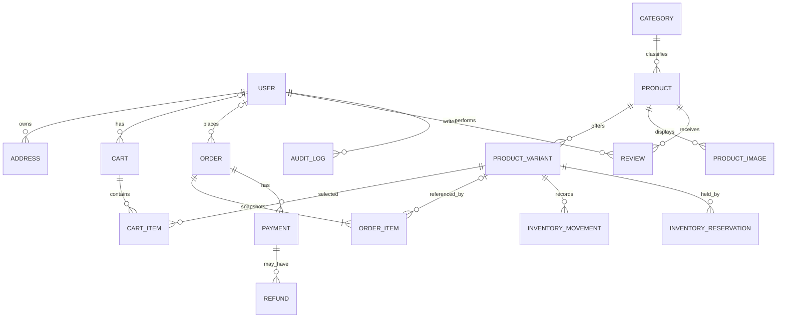

# CommerceCore — Database Design

**Database:** PostgreSQL · **ORM/migrations:** Prisma · **Status:** Logical baseline; align exact fields/types with `schema.prisma` before implementation.

## 1. Principles
- Normalize mutable domain data and enforce relationships with foreign keys.
- ProductVariant is the purchasable unit when SKU/price/stock differ by option.
- Snapshot product/SKU/price on order items.
- Use DB constraints as well as server validation.
- Record inventory movements and sensitive admin actions.
- Keep transactions short; use concurrency-safe stock writes.
- Archive entities referenced by history rather than cascading deletion of financial records.
- Use integer minor units or exact decimal types for money, never binary floating point.

## 2. Entities
| Entity | Purpose / notes |
|---|---|
| User | Customer/admin identity; normalized unique email, role/status |
| Address | Saved address; owner FK and ownership checks |
| Category | Taxonomy; unique slug; optional parent |
| Product | Catalog content; unique slug, status, category, brand |
| ProductVariant | Purchasable SKU, options, price, stock, threshold, status |
| ProductImage | Object key/URL, alt text, sort order; binary stays in object storage |
| Cart / CartItem | User or guest cart, variant, positive quantity, expiry/merge behavior |
| Coupon | Code, type/value, validity, minimum spend, usage limits, eligible products |
| CouponRedemption | Actor/order/coupon use record to enforce limits and prevent duplicate redemption |
| Order | Unique public order number, status, payment status, currency, totals, contact/shipping snapshots |
| OrderItem | Purchase-time name/SKU/unit price/quantity/discount/tax/line total snapshots |
| Payment | Provider, reference, amount/currency/status, idempotency key |
| WebhookEvent | Unique provider/event ID, event type, processing outcome, safe metadata |
| InventoryMovement | Variant, quantity delta, reason, actor, reference, timestamp |
| InventoryReservation | Optional temporary hold with status/expiry/consume/release timestamps |
| Refund | Amount/status/provider ID/idempotency key/actor/reason |
| OrderStatusHistory | From/to state, actor/system, timestamp, reason |
| OutboxEvent / Notification | Durable job identity, status, attempts, next retry, safe error |
| Review / WishlistItem | Optional verified review and saved product; uniqueness rules |
| AuditLog | Actor/action/entity and safe before/after metadata |

## 3. ER diagram

Guest orders may have no user FK; nullable/optional relations must be represented deliberately in the actual schema. The same applies to carts, which is why `USER o|--o{ CART` is optional on the user side: a guest cart is owned by an opaque token instead (see §10).

This diagram is illustrative and incomplete — COUPON, COUPON_REDEMPTION, ORDER_STATUS_HISTORY, WEBHOOK_EVENT and OUTBOX_EVENT are omitted, and REFUND also references ORDER. The entity table in §2 and `backend/prisma/schema.prisma` are authoritative.

## 4. Important fields and constraints
### User
`id`, normalized unique `email`, `name`, `role`, `status`, timestamps. Never store plaintext passwords; delegate credential handling to the selected auth provider/library.

### Product and ProductVariant
Product: `id`, `name`, unique `slug`, `description`, `brand`, `categoryId`, publication status/timestamps, nullable `featuredRank` (storefront order, > 0; ADR 0013). Variant: `id`, `productId`, unique `sku`, option values, price, currency policy, `stockQuantity`, `lowStockThreshold`, status. Enforce price >= 0, stock >= 0 and threshold >= 0 (SQL CHECK where ORM schema cannot express it).

### Cart
Store user owner or secure opaque guest token, status and expiry. Guest tokens must be high-entropy and treated as secrets. CartItem should have quantity > 0 and usually unique `(cartId, variantId)`; define merge behavior for duplicate/unavailable variants.

### Order / OrderItem
Order stores internal ID, unique public order number, nullable user ID for guest checkout, lifecycle/payment status, currency, subtotal/discount/shipping/tax/total, contact/shipping snapshots, coupon snapshot/reference, idempotency key/request fingerprint and timestamps. OrderItem stores nullable product/variant references plus snapshot name, SKU, unit price, quantity, line discount/tax and line total as needed. Preserve historical values after catalog edits. Avoid cascading deletion of orders when a product is archived/deleted.

### Payment / Refund
Payment: order FK, provider, provider reference, amount/currency/status/idempotency key and safe metadata. Refund: payment/order reference, amount, status, provider refund ID, idempotency key, actor and reason. Never store PAN/CVV.

### WebhookEvent
Store provider, event ID/type, received/processed timestamps, processing status, safe payload metadata/hash, attempt count and last error. Unique `(provider, eventId)`.

### InventoryMovement / Reservation
Every stock change and its reason/actor/reference should be recorded in the same transaction as the balance update. Reservation mode needs quantity, order/checkout reference, status and expiry. Consume/release/expire must be safe when repeated and race safely with payment success.

## 5. Index strategy
Validate with representative data and `EXPLAIN (ANALYZE, BUFFERS)`:
- Unique normalized email, product slug, SKU, public order number, `(provider,eventId)`, normalized coupon code.
- Catalog status/publication date, category and variant/product join keys; price index only if useful for query plan.
- Orders `(userId, createdAt DESC)` and `(status, createdAt DESC)`.
- Foreign keys and common cart owner/status lookups.
- Reservation status/expiry; outbox status/nextAttemptAt; reviews `(productId, createdAt DESC)`.
- Add only indexes that support real query patterns; indexes increase storage and write cost.

## 6. Transaction boundaries
### Decrement-on-order
Within one short transaction: reload trusted catalog/pricing/coupon/shipping; conditionally decrement each variant; create order and item snapshots; create payment/order initial state and inventory movements; insert outbox event. Any required failure rolls back all writes. For multiple variants, use stable ordering and handle deadlocks safely.

### Timed reservation (optional)
Within a short transaction, claim stock and create reservation/order state. Call provider after commit. Verified payment consumes reservation; terminal failure/expiry releases once. Define reconciliation for late payment after expiry before enabling this mode.

### Webhook
Verify signature first; insert event under unique constraint; ignore/reconcile duplicates; apply an allowed conditional state transition; commit; retry recoverable failures idempotently.

## 7. Money and currency
Choose a store currency for v1 unless multi-currency is a real requirement. Store currency on order/payment for historical correctness. Centralize rounding, discounts, shipping and tax in one server pricing service. Verify provider amount/currency against persisted expected values before marking paid.

## 8. Data lifecycle
Define account deletion, order/payment retention, audit retention and notification retention before launch. Anonymize where legally appropriate rather than deleting records needed for financial reconciliation. Minimize address/contact storage and restrict admin access. Keep production data out of fixtures and test logs. Test backup restoration.

## 9. Prisma notes
Encode relations/unique constraints/indexes in `schema.prisma`; add SQL CHECK constraints in migrations if needed. Review generated migrations. Seed/import must be repeatable and must not overwrite live stock/prices on rerun. Use integration tests against PostgreSQL for constraints and concurrency; mocks alone cannot prove race safety.

## 10. Implementation status
This section records how the logical baseline above was realized in `backend/prisma/`. Where the two differ, the schema is authoritative and the reason is given here.

**Implemented (23 models, 15 enums).** Identity (User, Session, Account, Verification), Address, Category, Product, ProductVariant, ProductImage, Cart, CartItem, Coupon, CouponProduct, Order, OrderItem, OrderStatusHistory, CouponRedemption, Payment, Refund, WebhookEvent, InventoryMovement, OutboxEvent, AuditLog. Tables and constraints only — no checkout, pricing, payment, refund or inventory *behavior* exists yet.

**Deferred, with reasons.**
- `InventoryReservation` — ADR 0004 is still Proposed. Until it is decided, `ProductVariant.stockQuantity` means **on-hand** stock. Adding reservations later changes that meaning and needs an available-vs-on-hand split.
- `Review`, `WishlistItem` — PRD §4 marks them optional and their uniqueness rules are undefined.
- `Notification` — §2 listed it jointly with OutboxEvent; one durable outbox covers the need, so a second table was not created.
- `StoreSettings` — shipping/tax/store policy is unresolved (PRD §9).

**Decisions taken.**
- Money and currency: see [ADR 0008](decisions/0008-money-and-currency.md). Percentages are integer basis points; `currency` lives on Order/Payment/Refund only.
- Coupon usage limits: a `usedCount` counter claimed by a conditional `UPDATE ... WHERE used_count < usage_limit`, mirroring the stock-claim pattern in architecture.md §8, with a CHECK as the backstop. A unique constraint alone cannot enforce a global limit.
- Variant options: `options Json` plus a canonical `optionKey` with a unique `(productId, optionKey)`, so one option combination cannot exist twice on a product.
- Cart ownership: nullable `userId` **or** a `guestTokenHash`, never both and never neither (CHECK), with partial unique indexes giving one ACTIVE cart per owner. Only the token hash is stored.
- Guest order access: `Order.guestAccessTokenHash` was added because §4 listed no such field while API_SPEC.md §6 requires an unguessable token for guest lookup. `orderNumber` must therefore be generated non-sequentially.
- Order deletion: `Order.userId` is `onDelete: Restrict`, so account closure must be anonymization, not deletion. `OrderItem` product/variant references are `SetNull` so even a hard delete cannot cascade into order history.
- Redundant fields removed from the baseline: no separate `guestEmail` on Order (`contactEmail` is always required), and no per-line `currency` on OrderItem.

**Constraints that live in migration SQL, not in `schema.prisma`.** 78 CHECK constraints and 3 partial unique indexes. Prisma does not model CHECK constraints and does not know about the partial indexes, so: never run `prisma db push`, and read every future `prisma migrate dev` file before applying it, deleting any `DROP CONSTRAINT`/`DROP INDEX` that targets one. `backend/tests/db/constraints.test.ts` asserts each one still exists, so an accidental drop fails the suite.

**Migration order.** `0001_identity`, `0002_catalog_and_addresses`, `0003_cart_and_coupons`, `0004_orders_payments_inventory`, `0005_outbox_and_audit`, `superadmin_role_and_auth_outbox`, `catalog_import_provenance`, `fix_source_identity_check`, `product_featured_rank`. Coupons precede orders because `Order.couponId` references them.

**Catalog import provenance (M3, [ADR 0011](decisions/0011-catalog-import-provenance.md)).** `Product.gender` (`MEN | WOMEN | UNISEX`, nullable); `Product.sourceProvider` + `sourceExternalId` (unique together, both-or-neither CHECK `products_source_identity_check`), `sourceUrl`, `sourceContentHash`; `ProductVariant.priceSource` (`MANUAL | SOURCE | SYNTHETIC`, default `MANUAL`); `ProductImage.sourceUrl`, `attribution`. All internal: none are returned by public endpoints. Store currency is BDT (ADR 0008 amendment).

**Featured ordering ([ADR 0013](decisions/0013-featured-dark-edit.md)).** `Product.featuredRank` (nullable, CHECK `products_featured_rank_positive_check`, indexed) drives the default `featured` listing order. Internal: not returned by public endpoints.

**Still open.** Guest checkout policy (PRD §9) — the schema is guest-capable either way; per-user coupon limits for guests, which have no identity to count against; data retention and deletion (§8), which decides whether anonymization is enough; and the inventory policy in ADR 0004.
